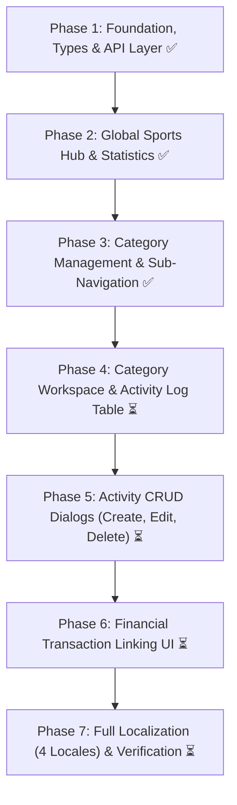

# 🏃 Sports Domain Frontend Implementation Plan

## Overview

This document defines the complete implementation plan for the **Sports Domain** in `finance-tracker-web-v2`. Built on React 19, TypeScript, Tailwind CSS, `@tanstack/react-query`, `react-hook-form`, `zod`, and `react-i18next`, aligned with backend API contracts generated from OpenAPI (`/api/sports/*`).

---

## 🗺️ Architectural Structure

The sports domain follows a **Two-Tier Architecture**:

1. **Tier 1: Global Sports Hub (`/sports`)**: Aggregate spending metrics across all sports, multi-year trend charts, and category breakdown.
2. **Tier 2: Category Workspace (`/sports/categories/:categoryId`)**: Granular sport activities/spendings log with sorting, filtering, entry CRUD modals, and transaction linking.
3. **Category Management Hub (`/sports/categories`)**: Centralized management for custom & system sport categories with favorite toggles and creation/deletion.

```
src/features/sports/
├── api/                            # HTTP client endpoints & OpenAPI types
│   ├── types.ts                    # Re-exported schema types from OpenAPI
│   ├── query-keys.ts               # sportsQueryKeys factory
│   ├── sport-categories-api.ts     # Category CRUD & favorites endpoints
│   ├── sport-entries-api.ts        # Sport activity/entry CRUD endpoints
│   ├── sport-spendings-api.ts      # Spending-to-transaction linking API
│   ├── sport-stats-api.ts          # Aggregate statistics endpoint
│   ├── sports-api.test.ts          # API client tests
│   └── index.ts                    # Public API exports
├── components/                     # Domain UI components
│   ├── index.ts                    # Public component exports
│   ├── layout/                     # Shared layout and sub-navigation
│   │   ├── sports-layout.tsx       # Shell with persistent sub-nav tabs
│   │   ├── sports-header.tsx       # Title bar with quick actions & mobile nav
│   │   ├── sports-tabs.tsx         # Filtered category tabs (entryCount > 0)
│   │   └── types.ts
│   ├── overview/                   # Tier 1: Global Hub (/sports)
│   │   ├── sports-overview-page.tsx
│   │   ├── sports-stats-cards.tsx  # Total Cost, Entries, Top Sport, Avg/Month
│   │   ├── sports-trend-chart.tsx  # Multi-year & monthly trend chart
│   │   ├── sports-category-breakdown.tsx # Category split table & progress
│   │   ├── sports-year-filter.tsx  # Year selector pill buttons
│   │   └── sports-overview-empty-state.tsx
│   ├── categories/                 # Category Management (/sports/categories)
│   │   ├── sports-categories-page.tsx
│   │   ├── sports-categories-list.tsx
│   │   ├── sport-category-item.tsx # Row with favorite & delete actions
│   │   ├── create-sport-category.tsx # Inline category creation form
│   │   └── sport-category-delete-modal.tsx
│   ├── category/                   # Tier 2: Category Workspace (/sports/categories/:categoryId)
│   │   ├── sport-category-page.tsx # Category activities dashboard
│   │   ├── sport-entries-table.tsx # Activity log table with action buttons
│   │   ├── sport-entries-filter-bar.tsx # Search, date range, and sort controls
│   │   └── sport-category-summary.tsx # Category summary cards
│   ├── modals/                     # Activity Dialogs & Drawers
│   │   ├── sport-entry-form-modal.tsx # Create & Edit activity modal
│   │   └── sport-entry-delete-modal.tsx # Delete confirmation modal
│   └── spendings/                  # Transaction Linking UI
│       ├── sport-spending-link-dialog.tsx # Link activity to financial transaction
│       └── sport-spending-unlink-modal.tsx # Unlink confirmation modal
├── hooks/                          # Custom React Query & modal state hooks
│   ├── index.ts
│   ├── use-sport-categories.ts
│   ├── use-sport-category-mutations.ts
│   ├── use-sport-entries.ts
│   ├── use-sport-entry-mutations.ts
│   ├── use-sport-stats.ts
│   ├── use-sport-record-modals.ts
│   ├── use-sport-spending-modal-state.ts
│   └── use-sport-spending-linking.ts
├── consts.ts                       # Domain colors, defaults, query limits
├── schemas.ts                      # Client-side Zod validation schemas
├── schemas.test.ts                 # Schema unit tests
├── types.ts                        # Internal feature types
└── utils.ts                        # Metric formatting & display helpers
```

---

## 📋 Implementation Roadmap



---

### ✅ Phase 1: Foundation, Types, Schemas & API Layer (Completed)

- [x] **Sub-phase 1.1: Project Setup & Path Aliases**
  - Configured `@sports` and `@sports/*` path aliases in `tsconfig.json` and `vite.config.ts`.
  - Initialized feature directory structure in `src/features/sports/`.
- [x] **Sub-phase 1.2: Domain Types Mapping from OpenAPI**
  - Mapped OpenAPI contracts from `components['schemas']` in `src/features/sports/api/types.ts`.
  - Defined `SportCategory`, `SportEntry`, `SportStatsResponse`, and filter query interfaces.
- [x] **Sub-phase 1.3: Constants & Query Keys**
  - Defined `SPORTS_CATEGORY_COLORS`, sort options, and limits in `consts.ts`.
  - Implemented `sportsQueryKeys` factory in `query-keys.ts`.
- [x] **Sub-phase 1.4: Client-side Zod Form Validation Schemas**
  - Implemented `sportCategorySchema` and `sportEntrySchema` in `schemas.ts`.
  - Added unit test suite in `schemas.test.ts`.
- [x] **Sub-phase 1.5: API Client Endpoints**
  - Implemented category endpoints (`getSportCategories`, `favoriteSportCategory`, etc.).
  - Implemented entry endpoints (`getSportEntries`, `createSportEntry`, etc.).
  - Implemented stats endpoint (`getSportStats`).
  - Implemented spending linking endpoints (`linkSportSpendings`, `unlinkSportSpending`).
  - Added unit tests in `sports-api.test.ts`.
- [x] **Sub-phase 1.6: React Query Data Hooks**
  - Implemented query & mutation hooks with cache invalidation and toast feedback.

---

### ✅ Phase 2: Global Sports Hub (`/sports`) (Completed)

- [x] **Sub-phase 2.1: Key Metric Cards**
  - Total Spendings (PLN), Total Activities count, Top Sport Category, Monthly Average.
- [x] **Sub-phase 2.2: Trend Chart**
  - Visual yearly spending bars and monthly breakdown chart.
- [x] **Sub-phase 2.3: Category Spending Breakdown**
  - List of categories with cost totals, activity counts, and progress bars.
- [x] **Sub-phase 2.4: Year Filtering**
  - Dynamic pill selector filtering stats by selected year while keeping lifetime totals accessible.
- [x] **Sub-phase 2.5: Empty State**
  - Friendly empty state illustration guiding users to log their first activity or category.

---

### ✅ Phase 3: Category Management & Persistent Sub-Navigation (Completed)

- [x] **Sub-phase 3.1: Sports Layout Shell**
  - Common layout header with hamburger toggle for mobile navigation.
  - Horizontal sub-navigation tabs next to "Overall" (Podgląd).
- [x] **Sub-phase 3.2: Filter Inactive Categories in Navigation**
  - Connected `useSportStats(undefined)` to filter tabs: only show categories with `entryCount > 0`.
  - Added safeguard preserving active category tab when directly navigated to.
- [x] **Sub-phase 3.3: Categories Management Page (`/sports/categories`)**
  - Distinct titles: `Kategorie sportów` / `Nowa kategoria sportu` to distinguish from transactions.
  - Favorite toggle, custom category creation, and delete modal with safety warnings.
- [x] **Sub-phase 3.4: Navigation & UI Store Auth Lifecycle**
  - Guaranteed `Navigation` mounts cleanly per authenticated user (`key={data?.id}`).
  - Reset UI store state (`totals`, `filters`, `currencies`) on login across tabs.

---

### ✅ Phase 4: Category Workspace & Activity Log Table (Completed)

- [x] **Sub-phase 4.1: Category Header & Summary Cards**
  - Implement `SportCategorySummary` showing category-specific stats:
    - Total spent in category (PLN)
    - Total activities logged
    - Spendings linked to transactions count & amount
- [x] **Sub-phase 4.2: Activities Filter Bar**
  - Search by item name / notes.
  - Date range filters (Start Date, End Date).
  - Sort selector (`date_desc`, `date_asc`, `cost_desc`, `cost_asc`).
  - Reset filters button.
- [x] **Sub-phase 4.3: Activities Log Table**
  - Responsive table / list for mobile and desktop.
  - Columns: Date, Activity / Item Name, Cost (PLN), Transaction Link Badge, Actions.
  - Empty state when category has no activities.
  - Pagination controls (`page`, `limit`).
- [x] **Sub-phase 4.4: Integration & Route Testing**
  - Mount in `SportCategoryPage` (`/sports/categories/:categoryId`).
  - Unit tests for filtering, sorting, and pagination.

---

### ✅ Phase 5: Activity CRUD Dialogs (Create, Edit, Delete)

- [x] **Sub-phase 5.1: Create Activity Dialog / Drawer**
  - Form fields: Date, Item / Activity Name, Cost (PLN) (no description field — name serves as description).
  - Category selector (pre-selected to current category).
  - Quick action button in `SportsHeader` and in category workspace table.
- [x] **Sub-phase 5.2: Edit Activity Dialog / Drawer**
  - Pre-filled form with existing activity data (Date, Item Name, Cost).
  - Invalidate `sportsQueryKeys.entries()` and `sportsQueryKeys.stats()` on update.
- [x] **Sub-phase 5.3: Delete Activity Confirmation Modal**
  - Danger confirmation modal detailing item name, date, and cost.
  - Handle unlinking automatically if linked to a transaction.
- [x] **Sub-phase 5.4: Unit Tests for Activity Modals**
  - Form validation error tests, successful mutation submissions, and modal transitions.

---

### ⏳ Phase 6: Financial Transaction Linking UI

- [ ] **Sub-phase 6.1: Link Activity to Transaction Dialog**
  - Modal displaying recent eligible transactions for linking.
  - Support linking multiple sport activities to a single transaction.
  - Connect with `useSportSpendingLinking` mutation hook.
- [ ] **Sub-phase 6.2: Unlink Activity Confirmation Modal**
  - Modal displaying linked transaction details before severing relationship.
- [ ] **Sub-phase 6.3: Transaction Details Integration**
  - Visual indicators in transactions domain for transactions linked to sports activities.
  - Jump-to-sport action from transaction drawer.

---

### ⏳ Phase 7: Localization (4 Locales) & Final Verification

- [ ] **Sub-phase 7.1: Translation Keys Completeness**
  - Update `sports.json` across all 4 locales: `en`, `pl`, `de`, `ru`.
  - Verify activity table headers, modal labels, empty state text, and toast alerts.
- [ ] **Sub-phase 7.2: Responsive Design & Dark Mode Audit**
  - Test on mobile viewports (< 640px), tablets (640px–1024px), and desktop.
  - Verify smooth contrast and tokens under both light and dark themes.
- [ ] **Sub-phase 7.3: Test Suite & Linter Sign-off**
  - Run full test suite: `npx vitest run src/features/sports`.
  - Type-check: `pnpm tsc --noEmit`.
  - Format & lint: `npm run fix`.
