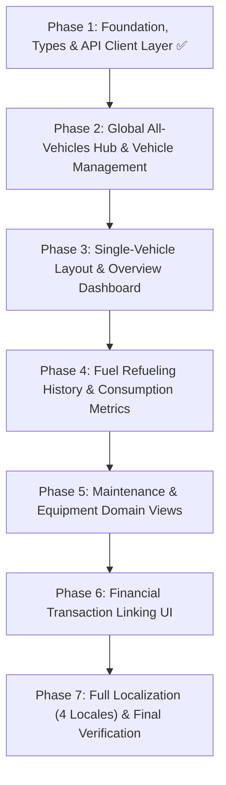

# 🚗 Vehicles Domain Frontend Implementation Plan

## Overview

This document outlines the phased roadmap for implementing the **Vehicles domain** in `finance-tracker-web-v2`. It is built on React 19, TypeScript, Tailwind CSS, `@tanstack/react-query`, `react-hook-form`, `zod`, and `react-i18next`, aligned with backend API contracts generated from OpenAPI.

---

## 🗺️ Architectural Structure

The vehicles domain follows a **Two-Tier Architecture**:

1. **Tier 1: Global All-Vehicles Hub (`/vehicles`)**: Aggregated spending summaries across all vehicles and a grid/list of vehicle cards for navigation.
2. **Tier 2: Single-Vehicle Workspace (`/vehicles/:vehicleSlug`)**: Dedicated vehicle header with sub-navigation tabs (`Overview`, `Fuel`, `Maintenance`, `Equipment`) and granular spending/activity details.

```
src/features/vehicles/
├── api/                            # HTTP client endpoints & generated DTOs
│   ├── types.ts                    # Re-exported schema types from OpenAPI
│   ├── index.ts                    # Public API client exports
│   ├── get-vehicles.ts             # Vehicle CRUD endpoints
│   ├── get-vehicle.ts
│   ├── create-vehicle.ts
│   ├── update-vehicle.ts
│   ├── delete-vehicle.ts
│   ├── get-fuel-entries.ts         # Fuel log endpoints
│   ├── get-fuel-entry.ts
│   ├── create-fuel-entry.ts
│   ├── update-fuel-entry.ts
│   ├── delete-fuel-entry.ts
│   ├── get-equipment.ts            # Equipment endpoints
│   ├── get-equipment-item.ts
│   ├── create-equipment.ts
│   ├── update-equipment.ts
│   ├── delete-equipment.ts
│   ├── get-maintenance.ts          # Maintenance endpoints
│   ├── get-maintenance-item.ts
│   ├── create-maintenance.ts
│   ├── update-maintenance.ts
│   ├── delete-maintenance.ts
│   ├── link-spendings.ts           # Spending-to-transaction linking
│   ├── unlink-spending.ts
│   ├── vehicles-api.test.ts        # Focused test suites
│   ├── vehicles-fuel-api.test.ts
│   ├── vehicles-equipment-api.test.ts
│   ├── vehicles-maintenance-api.test.ts
│   └── vehicles-spendings-api.test.ts
├── components/                     # Domain UI components
│   ├── index.ts                    # Public component exports
│   ├── vehicles-page.tsx           # Global overview page (/vehicles)
│   ├── all-vehicles/               # Tier 1: All-Vehicles Hub
│   │   ├── global-summary-cards/   # Aggregated spending cards (Total, Fuel, Maintenance, Equipment)
│   │   └── vehicle-card/           # Individual vehicle summary card & grid
│   ├── single-vehicle/             # Tier 2: Single-Vehicle Workspace
│   │   ├── vehicle-layout/         # Shared header, "Back to all vehicles", and sub-tabs
│   │   ├── vehicle-tabs.tsx        # Tabs: Overview, Fuel, Maintenance, Equipment
│   │   └── overview/               # /vehicles/:vehicleSlug (Overview Tab)
│   │       ├── spending-breakdown/ # Category split (Fuel, Maintenance sections, Equipment, Total)
│   │       ├── vehicle-stats/      # Lifetime metrics, odometer, consumption
│   │       └── recent-activity/    # Chronological recent logs across all categories
│   ├── fuel/                       # /vehicles/:vehicleSlug/fuel
│   ├── equipment/                  # /vehicles/:vehicleSlug/equipment
│   ├── maintenance/                # /vehicles/:vehicleSlug/maintenance
│   ├── spendings/                  # Spending link dialogs & popovers
│   └── vehicle-modals/             # Create, Edit, and Delete vehicle dialogs
├── consts.ts                       # Domain constants, enum arrays & query keys factory
├── schemas.ts                      # Client-side Zod form validation schemas
├── schemas.test.ts                 # Form validation unit tests
├── types.ts                        # Feature types entrypoint
└── utils.ts                        # Metric formatters and calculation helpers
```

---

## 📋 Implementation Roadmap



---

### ✅ Phase 1: Foundation, Types, Schemas & API Layer (Completed)

- [x] **Sub-phase 1.1: Project Setup & Path Aliases**
  - Add `@vehicles` and `@vehicles/*` aliases to `tsconfig.json` and `vite.config.ts`.
  - Initialize feature directory structure in `src/features/vehicles/`.
- [x] **Sub-phase 1.2: Domain Types Mapping from OpenAPI**
  - Extract and export typed contracts from `components['schemas']` in `src/features/vehicles/api/types.ts`.
  - Define `Vehicle`, `VehicleFuelEntry`, `VehicleEquipment`, `VehicleMaintenance`, and query filter DTOs.
- [x] **Sub-phase 1.3: Constants & Query Keys**
  - Define `VEHICLE_TYPES`, `MAINTENANCE_SECTIONS`, `SPENDING_TYPES` in `consts.ts`.
  - Implement `vehiclesQueryKeys` factory for React Query cache management.
- [x] **Sub-phase 1.4: Client Form Validation Schemas**
  - Implement Zod schemas in `schemas.ts` (`vehicleFormSchema`, `fuelEntryFormSchema`, `equipmentFormSchema`, `maintenanceFormSchema`, `linkSpendingsFormSchema`).
- [x] **Sub-phase 1.5: API Client Endpoints**
  - Implement focused API functions for Vehicles, Fuel, Equipment, Maintenance, and Spending Links.
  - Export public interface via `src/features/vehicles/api/index.ts`.
- [x] **Sub-phase 1.6: Unit Testing & Verification**
  - Write domain-specific API tests (`vehicles-api.test.ts`, `vehicles-fuel-api.test.ts`, `vehicles-equipment-api.test.ts`, `vehicles-maintenance-api.test.ts`, `vehicles-spendings-api.test.ts`).
  - Write validation tests in `schemas.test.ts`.

---

### 🚧 Phase 2: Global All-Vehicles Hub & Vehicle Management (`/vehicles`)

- [x] **Sub-phase 2.1: Route Registration & Page Entrypoints**
  - Register `/vehicles`, `/vehicles/:vehicleSlug`, `/vehicles/:vehicleSlug/{fuel,equipment,maintenance}` in `app-routes.tsx`.
  - Create lazy-loaded page entrypoints in `src/features/vehicles/components/`.
- [ ] **Sub-phase 2.2: Global Spending Summary & Vehicle Cards Grid**
  - Implement aggregated spending calculation across all user vehicles (Total PLN, Fuel PLN, Maintenance PLN, Equipment PLN).
  - `GlobalSpendingSummaryCards`: Metric cards showing fleet totals and category breakdowns.
  - `VehicleCard` & `VehicleCardsGrid`: Cards displaying vehicle name, type badge (`car`, `motorcycle`, `public_transport`), brand/model, individual total spent, last odometer, and quick navigation button to `/vehicles/:vehicleSlug`.
  - Empty state component when user has 0 vehicles with a "Create First Vehicle" call to action.
- [ ] **Sub-phase 2.3: Vehicle CRUD Modals**
  - `CreateVehicleModal`: Modal form with type selector (motorcycle, car, public transport), name, slug, brand, model, year, and notes.
  - `UpdateVehicleModal`: Modal dialog to edit vehicle metadata and notes.
  - `DeleteVehicleModal`: Confirmation dialog with safety warnings and cache invalidation.
- [ ] **Sub-phase 2.4: Phase 2 Localization & Layout Tests**
  - Add vehicle hub, cards, and modal translations in `vehicles.json` across `en`, `pl`, `de`, `ru`.
  - Write component unit tests for `VehiclesPage`, `VehicleCard`, and vehicle modals.

---

### ⏳ Phase 3: Single-Vehicle Layout & Overview Dashboard (`/vehicles/:vehicleSlug`)

- [ ] **Sub-phase 3.1: Single-Vehicle Layout & Navigation**
  - Implement `SingleVehicleLayout` with vehicle header info (name, badge, brand/model, production year, edit/delete actions).
  - "Back to all vehicles" link leading back to `/vehicles`.
  - Sub-navigation tabs: **Overview** (`/vehicles/:vehicleSlug`), **Fuel** (`/vehicles/:vehicleSlug/fuel`), **Equipment** (`/vehicles/:vehicleSlug/equipment`), **Maintenance** (`/vehicles/:vehicleSlug/maintenance`).
- [ ] **Sub-phase 3.2: Vehicle Overview Dashboard & Spending Breakdown**
  - `VehicleSpendingBreakdown`: Total spent on this vehicle with category split:
    - ⛽ **Fuel**: Total PLN spent, total liters, average consumption (L/100 km), cost per km.
    - 🔧 **Maintenance**: Total PLN spent, broken down by section (`own_maintenance`, `previous_owner_services`, `driving_licence_costs`).
    - 🧰 **Equipment**: Total PLN spent, item count.
  - `VehicleStatsCards`: Current odometer, total distance logged, total refueling sessions, total maintenance events.
  - `RecentActivityFeed`: Combined chronological stream of recent fuel entries, maintenance, and equipment purchases.
- [ ] **Sub-phase 3.3: Phase 3 Tests & Localization**
  - Add vehicle overview dashboard translations in `vehicles.json`.
  - Write unit tests for spending aggregations and overview dashboard components.

---

### ⏳ Phase 4: Fuel Refueling History & Dynamic Metrics UI (`/vehicles/:vehicleSlug/fuel`)

- [ ] **Sub-phase 4.1: Fuel Calculation Helpers & UI Formatters**
  - Implement pure utility formatters in `src/features/vehicles/utils.ts` for consumption (`L/100km`), cost per km (`PLN/km`), efficiency (`km/L`), and delta distances.
- [ ] **Sub-phase 4.2: Fuel Filter Bar & Summary Header**
  - Date range picker (`startDate`, `endDate`).
  - Full-tank only toggle (`isFullTank`).
  - Quick summary header (total fuel volume pumped, total cost PLN, recent average consumption).
- [ ] **Sub-phase 4.3: Fuel Entries Table & Mobile Card List**
  - Columns: Date, Odometer reading (`km`), Delta distance (`+km`), Liters, Unit Price (`PLN/L`), Cost (`PLN`), Gas Station brand & address, Full Tank badge.
  - Dynamic metric badge: Consumption `L/100km` and Cost/km for consecutive full-tank fill-ups.
- [ ] **Sub-phase 4.4: Fuel Entry CRUD Modals**
  - `CreateFuelEntryModal`: Form with auto-calculation helper between liters, unit price, and total cost.
  - `UpdateFuelEntryModal`: Form to adjust existing fuel log records.
  - `DeleteFuelEntryModal`: Confirmation dialog.
- [ ] **Sub-phase 4.5: Phase 4 Tests & Localization**
  - Add fuel table and form translations.
  - Unit tests for fuel formatters and table component rendering.

---

### ⏳ Phase 5: Maintenance & Equipment Domain Views (`/vehicles/:vehicleSlug/{maintenance,equipment}`)

- [ ] **Sub-phase 5.1: Maintenance Domain View (`maintenance/`)**
  - Section switcher pills / tabs:
    - 🔧 _Own Maintenance_ (`own_maintenance`)
    - 📋 _Previous Owner Services_ (`previous_owner_services`)
    - 🪪 _Driving Licence Costs_ (`driving_licence_costs`)
  - `MaintenanceTable`: Date, Section, Service Provider, Odometer, Cost PLN, Description, linked transaction status.
  - `CreateMaintenanceModal` & `UpdateMaintenanceModal`.
  - `DeleteMaintenanceModal` confirmation dialog.
- [ ] **Sub-phase 5.2: Equipment Domain View (`equipment/`)**
  - `VehicleEquipmentPage`: Table/grid displaying equipment items (Item Name, Date, Cost PLN, Description, linked transaction status).
  - `CreateEquipmentModal` & `UpdateEquipmentModal`.
  - `DeleteEquipmentModal` confirmation dialog.
- [ ] **Sub-phase 5.3: Phase 5 Tests & Localization**
  - Add equipment and maintenance translation keys across `en`, `pl`, `de`, `ru`.
  - Write component unit tests for equipment and maintenance views.

---

### ⏳ Phase 6: Financial Transaction Linking UI (`spendings/`)

- [ ] **Sub-phase 6.1: Spending Link / Unlink Modals**
  - `LinkSpendingModal`: Search & link an unlinked vehicle spending item (fuel, maintenance, equipment) to an existing financial `Transaction`.
  - `UnlinkSpendingModal` / quick action in row action dropdowns.
- [ ] **Sub-phase 6.2: Table Row Integrations & Transaction Navigation**
  - Visual indicator badge showing linked transaction status in Fuel, Maintenance, and Equipment tables.
  - Direct navigation link to transaction details (`/transactions/:transactionId`).
- [ ] **Sub-phase 6.3: Phase 6 Tests & Localization**
  - Unit tests for spending linking hooks and modal flows.

---

### ⏳ Phase 7: Full Localization (4 Locales), Polish & Final Verification

- [ ] **Sub-phase 7.1: Localization Completeness**
  - Ensure all 4 locale files (`en`, `pl`, `de`, `ru`) in `src/shared/i18n/locales/` have 100% complete translations for `vehicles.json` and `vehicle-errors.json`.
- [ ] **Sub-phase 7.2: Responsive Design & Polishing**
  - Validate mobile viewport responsiveness, drawer behavior, and glassmorphism styling.
- [ ] **Sub-phase 7.3: End-to-End Quality Verification**
  - Run full test suite:
    ```bash
    pnpm test:coverage
    pnpm tsc --noEmit
    npm run fix
    ```
