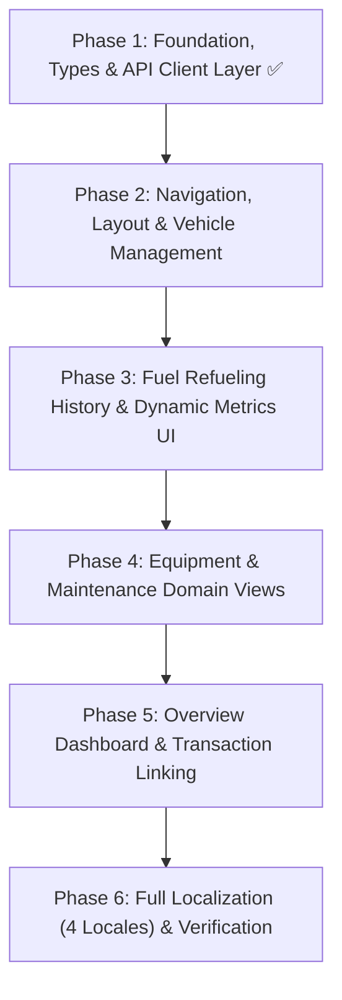

# 🚗 Vehicles Domain Frontend Implementation Plan

## Overview

This document outlines the phased roadmap for implementing the **Vehicles domain** in `finance-tracker-web-v2`. It is built on React 19, TypeScript, Tailwind CSS, `@tanstack/react-query`, `react-hook-form`, `zod`, and `react-i18next`, aligned with backend API contracts generated from OpenAPI.

---

## 🗺️ Architectural Structure

```
src/features/vehicles/
├── api/                            # HTTP client endpoints & generated DTOs
│   ├── types.ts                    # Re-exported schema types from OpenAPI
│   ├── index.ts                    # Public API client exports
│   ├── get-vehicles.ts             # Vehicle CRUD endpoints
│   ├── get-vehicle.ts
│   ├── create-vehicle.ts
│   ├── update-vehicle.ts
│   ├── delete-vehicle.ts
│   ├── get-fuel-entries.ts         # Fuel log endpoints
│   ├── get-fuel-entry.ts
│   ├── create-fuel-entry.ts
│   ├── update-fuel-entry.ts
│   ├── delete-fuel-entry.ts
│   ├── get-equipment.ts            # Equipment endpoints
│   ├── get-equipment-item.ts
│   ├── create-equipment.ts
│   ├── update-equipment.ts
│   ├── delete-equipment.ts
│   ├── get-maintenance.ts          # Maintenance endpoints
│   ├── get-maintenance-item.ts
│   ├── create-maintenance.ts
│   ├── update-maintenance.ts
│   ├── delete-maintenance.ts
│   ├── link-spendings.ts           # Spending-to-transaction linking
│   ├── unlink-spending.ts
│   ├── vehicles-api.test.ts        # Focused test suites
│   ├── vehicles-fuel-api.test.ts
│   ├── vehicles-equipment-api.test.ts
│   ├── vehicles-maintenance-api.test.ts
│   └── vehicles-spendings-api.test.ts
├── components/                     # Domain UI components
│   ├── index.ts                    # Public component exports
│   ├── vehicles-layout/            # Shared vehicle switcher header & sub-tabs
│   ├── vehicles-page.tsx           # Route redirector / index wrapper
│   ├── overview/                   # Overview statistics & summary cards
│   ├── fuel/                       # Fuel log table, metrics badges, filters & modals
│   ├── equipment/                  # Equipment item cards/table & modals
│   ├── maintenance/                # Section-filtered maintenance table & modals
│   ├── spendings/                  # Spending link dialogs & popovers
│   └── vehicle-modals/             # Create, Edit, and Delete vehicle dialogs
├── consts.ts                       # Domain constants, enum arrays & query keys factory
├── schemas.ts                      # Client-side Zod form validation schemas
├── schemas.test.ts                 # Form validation unit tests
├── types.ts                        # Feature types entrypoint
└── utils.ts                        # Metric formatters and calculation helpers
```

---

## 📋 Implementation Roadmap



---

### ✅ Phase 1: Foundation, Types, Schemas & API Layer (Completed)

- [x] **Sub-phase 1.1: Project Setup & Path Aliases**
  - Add `@vehicles` and `@vehicles/*` aliases to `tsconfig.json` and `vite.config.ts`.
  - Initialize feature directory structure in `src/features/vehicles/`.
- [x] **Sub-phase 1.2: Domain Types Mapping from OpenAPI**
  - Extract and export typed contracts from `components['schemas']` in `src/features/vehicles/api/types.ts`.
  - Define `Vehicle`, `VehicleFuelEntry`, `VehicleEquipment`, `VehicleMaintenance`, and query filter DTOs.
- [x] **Sub-phase 1.3: Constants & Query Keys**
  - Define `VEHICLE_TYPES`, `MAINTENANCE_SECTIONS`, `SPENDING_TYPES` in `consts.ts`.
  - Implement `vehiclesQueryKeys` factory for React Query cache management.
- [x] **Sub-phase 1.4: Client Form Validation Schemas**
  - Implement Zod schemas in `schemas.ts` (`vehicleFormSchema`, `fuelEntryFormSchema`, `equipmentFormSchema`, `maintenanceFormSchema`, `linkSpendingsFormSchema`).
- [x] **Sub-phase 1.5: API Client Endpoints**
  - Implement focused API functions for Vehicles, Fuel, Equipment, Maintenance, and Spending Links.
  - Export public interface via `src/features/vehicles/api/index.ts`.
- [x] **Sub-phase 1.6: Unit Testing & Verification**
  - Write domain-specific API tests (`vehicles-api.test.ts`, `vehicles-fuel-api.test.ts`, `vehicles-equipment-api.test.ts`, `vehicles-maintenance-api.test.ts`, `vehicles-spendings-api.test.ts`).
  - Write validation tests in `schemas.test.ts`.

---

### 🚧 Phase 2: Navigation, Layout & Vehicle Management

- [x] **Sub-phase 2.1: Route Registration & Page Entrypoints**
  - Register `/vehicles`, `/vehicles/:vehicleSlug/overview`, `/vehicles/:vehicleSlug/fuel`, `/vehicles/:vehicleSlug/equipment`, `/vehicles/:vehicleSlug/maintenance` in `app-routes.tsx`.
  - Create lazy-loaded page entrypoints in `src/features/vehicles/components/`.
- [ ] **Sub-phase 2.2: VehiclesLayout & Vehicle Switcher**
  - Implement `VehiclesLayout` wrapper with responsive subgrid styling.
  - Top bar with **Vehicle Selector / Switcher** dropdown (fetching user's vehicles via React Query).
  - Sub-navigation tabs: **Overview**, **Fuel**, **Equipment**, **Maintenance**.
  - Empty state component when user has 0 vehicles with a "Create First Vehicle" call to action.
- [ ] **Sub-phase 2.3: Vehicle CRUD Modals**
  - `CreateVehicleModal`: Modal form with type selector (motorcycle, car, public transport), name, slug, brand, model, year, and notes.
  - `UpdateVehicleModal`: Modal dialog to edit vehicle metadata and notes.
  - `DeleteVehicleModal`: Confirmation dialog with safety warnings and cache invalidation.
- [ ] **Sub-phase 2.4: Phase 2 Localization & Layout Tests**
  - Add vehicle layout and modal translations in `vehicles.json` across `en`, `pl`, `de`, `ru`.
  - Write component unit tests for `VehiclesLayout` and vehicle modals.

---

### ⏳ Phase 3: Fuel Refueling History & Dynamic Metrics UI

- [ ] **Sub-phase 3.1: Fuel Calculation Helpers & UI Formatters**
  - Implement pure utility formatters in `src/features/vehicles/utils.ts` for consumption (`L/100km`), cost per km (`PLN/km`), efficiency (`km/L`), and delta distances.
- [ ] **Sub-phase 3.2: Fuel Filter Bar & Summary Badge**
  - Date range picker (`startDate`, `endDate`).
  - Full-tank only toggle (`isFullTank`).
  - Quick summary header (total fuel volume pumped, total cost PLN, recent average consumption).
- [ ] **Sub-phase 3.3: Fuel Entries Table & Mobile Card List**
  - Columns: Date, Odometer reading (`km`), Delta distance (`+km`), Liters, Unit Price (`PLN/L`), Cost (`PLN`), Gas Station brand & address, Full Tank badge.
  - Dynamic metric badge: Consumption `L/100km` and Cost/km for consecutive full-tank fill-ups.
- [ ] **Sub-phase 3.4: Fuel Entry CRUD Modals**
  - `CreateFuelEntryModal`: Form with auto-calculation helper between liters, unit price, and total cost.
  - `UpdateFuelEntryModal`: Form to adjust existing fuel log records.
  - `DeleteFuelEntryModal`: Confirmation dialog.
- [ ] **Sub-phase 3.5: Phase 3 Tests & Localization**
  - Add fuel table and form translations.
  - Unit tests for fuel formatters and table component rendering.

---

### ⏳ Phase 4: Equipment & Maintenance Domain Views

- [ ] **Sub-phase 4.1: Equipment Domain View (`equipment/`)**
  - `VehicleEquipmentPage`: Table/grid displaying equipment items (Item Name, Date, Cost PLN, Description, linked transaction status).
  - `CreateEquipmentModal` & `UpdateEquipmentModal`.
  - `DeleteEquipmentModal` confirmation dialog.
- [ ] **Sub-phase 4.2: Maintenance Domain View (`maintenance/`)**
  - Section switcher pills / tabs:
    - 🔧 _Own Maintenance_ (`own_maintenance`)
    - 📋 _Previous Owner Services_ (`previous_owner_services`)
    - 🪪 _Driving Licence Costs_ (`driving_licence_costs`)
  - `MaintenanceTable`: Date, Section, Service Provider, Odometer, Cost PLN, Description, linked transaction status.
  - `CreateMaintenanceModal` & `UpdateMaintenanceModal`.
  - `DeleteMaintenanceModal` confirmation dialog.
- [ ] **Sub-phase 4.3: Phase 4 Tests & Localization**
  - Add equipment and maintenance translation keys.
  - Write component unit tests for equipment and maintenance views.

---

### ⏳ Phase 5: Overview Dashboard & Transaction Linking

- [ ] **Sub-phase 5.1: Overview Dashboard Metrics (`overview/`)**
  - Vehicle overview summary cards:
    - 📈 Total Distance Traveled / Current Odometer
    - ⛽ Total Fuel Spent & Lifetime Average Consumption
    - 🛠️ Total Maintenance & Repair Expenses
    - 🪖 Total Equipment & Accessories Expenses
    - 💰 Total Cost of Ownership (TCO) in PLN
  - Quick-action shortcuts ("Log Refueling", "Add Maintenance", "New Equipment").
- [ ] **Sub-phase 5.2: Financial Transaction Linking UI (`spendings/`)**
  - `LinkSpendingModal`: Search & link an unlinked vehicle spending item to an existing financial `Transaction`.
  - Quick `Unlink` button in row action dropdowns.
  - Direct navigation link to transaction details (`/transactions/:transactionId`).
- [ ] **Sub-phase 5.3: Phase 5 Tests & Localization**
  - Unit tests for Overview metrics computations and Linking modal.

---

### ⏳ Phase 6: Full Localization, Polish & Verification

- [ ] **Sub-phase 6.1: Localization Completeness**
  - Ensure all 4 locale files (`en`, `pl`, `de`, `ru`) in `src/shared/i18n/locales/` have 100% complete translations for `vehicles.json` and `vehicle-errors.json`.
- [ ] **Sub-phase 6.2: Responsive Design & Polishing**
  - Validate mobile viewport responsiveness, drawer behavior, and glassmorphism styling.
- [ ] **Sub-phase 6.3: End-to-End Quality Verification**
  - Run full test suite:
    ```bash
    pnpm test:coverage
    pnpm tsc --noEmit
    npm run fix
    ```
